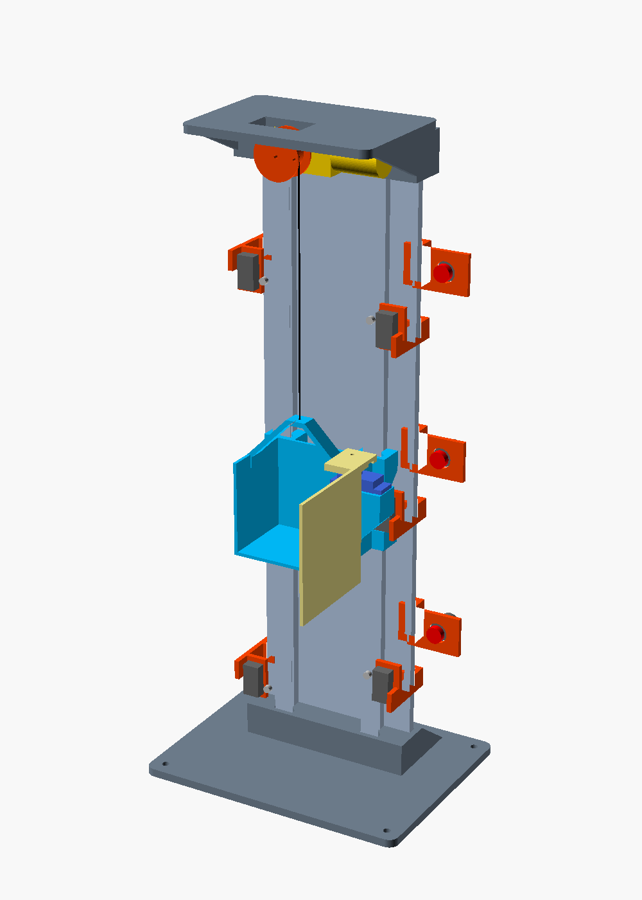
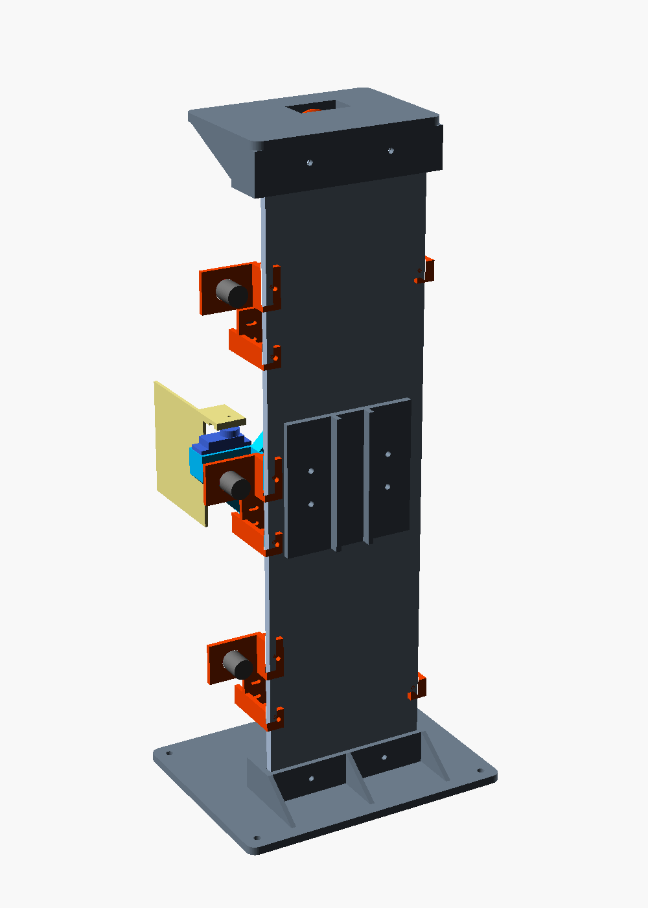
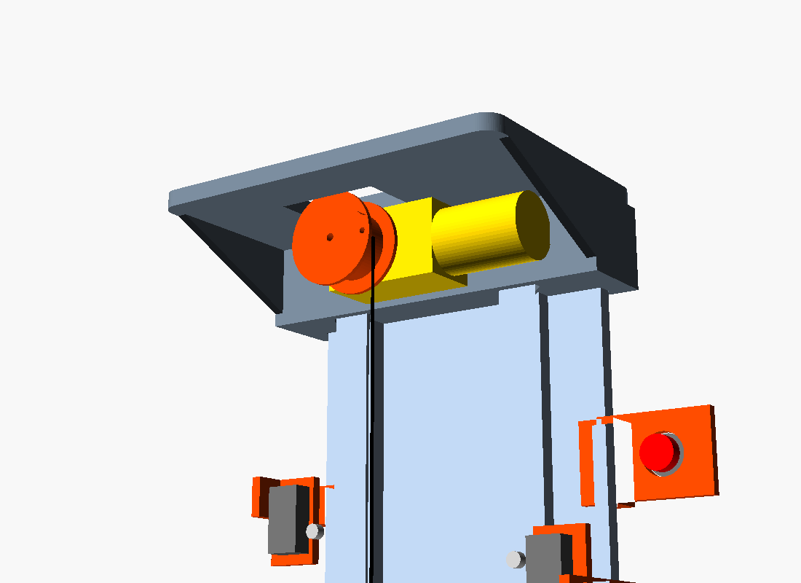

# Protótipo mecânico com estrutura toda impressa

Segunda proposta de estrutura para o mini elevador de três andares, sem varões nem barras: a torre é uma coluna impressa em dois segmentos, com trilhos em cauda de andorinha onde a cabine corre. Modelo de 18/11/2026, **ainda não impresso nem montado**. A primeira proposta, com três varões de 8 mm, está em [mecanica/](../mecanica/README.md).

| Vista frontal | Vista de trás | Motor sob o teto |
|---|---|---|
|  |  |  |

## O que continua sendo comprado

A estrutura é toda impressa. Ainda é preciso ter:

- 1 motor TT com redução e eixo de dois chanfros.
- 1 servo tipo SG90 com o braço reto, os dois parafusos das abas e o parafuso central que vêm com ele.
- 5 microchaves pequenas com alavanca de rolete, tipo KW12.
- 3 botões de pulso NA de 12 mm com rosca, um por andar.
- Cerca de 1 m de linha fina e resistente.
- Parafusos: 2 M3 × 25 (motor), 8 M3 × 8 (coluna na base, na emenda e na cabeça), 8 M3 × 8 (grampos e botoeiras), 10 M2 × 12 com porca (microchaves) e 1 parafuso pequeno para a ponta do eixo.

Os M3 abrem rosca direto no plástico, sem porca.

## Como funciona

- **Coluna.** Dois segmentos iguais de 195 mm, com 100 mm de largura e dois trilhos na frente. Uma emenda parafusada nas costas une os dois. A torre montada tem 400 mm.
- **Base e cabeça.** Cada uma tem um encaixe com o formato da coluna e dos trilhos, travado por dois parafusos pelas costas.
- **Acionamento.** O motor TT fica deitado sob o teto, parafusado na frente do encaixe da cabeça. O tambor de 20 mm fica no eixo e o fio desce direto até a alça da cabine.
- **Cabine.** Tem quatro sapatas atrás que abraçam os trilhos. Fica em balanço na frente da coluna.
- **Porta.** Um servo tipo SG90 entra por cima num alojamento na lateral direita da cabine, com o eixo para cima. A porta é uma placa presa ao braço (horn) do servo e gira 90° para fora. [Fechada](img/porta_fechada.png) · [aberta](img/porta_aberta.png)
- **Sensores.** A cabine tem um ressalto em cada lateral. Cada microchave fica num grampo que prende na borda da coluna e desliza na altura. Três grampos na borda direita marcam os andares; dois na esquerda, virados de cabeça para baixo, são os fins de curso.
- **Chamadas.** Cada andar tem uma botoeira que prende na borda direita da coluna, acima da microchave do andar, com um botão de pulso de 12 mm numa aba frontal para fora da coluna.
- **Eletrônica.** Placa, ponte H, LCD, joystick, parada e alimentação ficam na [caixa de eletrônica](../painel/README.md), ao lado da torre.
- **Percurso.** 110 mm entre andares, 220 mm no total, com 14 mm de folga abaixo do térreo e 27 mm acima do 2º andar.

## Peças para imprimir

| Arquivo | Qtde | Tamanho (mm) | Posição na mesa |
|---|---|---|---|
| [stl/gabarito.stl](stl/gabarito.stl) | 1 | 64 × 105 × 19 | Como está. **Imprimir primeiro.** |
| [stl/segmento.stl](stl/segmento.stl) | 2 | 100 × 195 × 19 | Costas na mesa, trilhos para cima |
| [stl/base.stl](stl/base.stl) | 1 | 170 × 130 × 25 | Placa na mesa |
| [stl/cabeca.stl](stl/cabeca.stl) | 1 | 116 × 81 × 30 | Teto na mesa (o STL já vem virado) |
| [stl/emenda.stl](stl/emenda.stl) | 1 | 80 × 80 × 10 | Face lisa na mesa |
| [stl/cabine.stl](stl/cabine.stl) | 1 | 80 × 63 × 83 | Piso na mesa |
| [stl/porta.stl](stl/porta.stl) | 1 | 81 × 71 × 19 | Face da frente na mesa |
| [stl/botoeira.stl](stl/botoeira.stl) | 3 | 41 × 15 × 24 | Como está |
| [stl/grampo.stl](stl/grampo.stl) | 5 | 16 × 39 × 26 | Como está |
| [stl/tambor.stl](stl/tambor.stl) | 1 | Ø28 × 14 | Flange reta na mesa |

Todas cabem numa mesa de 220 × 220 mm e foram desenhadas para imprimir sem suportes. Sugestão de partida: PLA, camada de 0,2 mm, 3 perímetros, 20% de preenchimento. O segmento ocupa quase toda a mesa no comprimento; use aba (brim) se as pontas levantarem, porque empeno nos trilhos faz a cabine prender.

## Antes de imprimir tudo

O gabarito tem quatro pedaços e testa os encaixes de que o projeto depende:

1. **Trilho e sapata.** A sapata deve correr pelo trecho de trilho com o próprio peso, sem folga lateral perceptível. Este é o teste mais importante.
2. **Barra.** O eixo do motor deve entrar firme no furo de dois chanfros. Um M3 deve passar no segundo furo e abrir rosca no terceiro. Um M2 deve passar no quarto. A fenda na ponta deve entrar justa na espessura do trecho de coluna.
3. **Chapa.** O furo grande e os dois pequenos devem coincidir com o eixo e os furos de fixação do motor real.

O alojamento do servo não está no gabarito. Meça o corpo do servo (nominal 22,8 × 12,2 mm, furos a 27,8 mm) antes de imprimir a cabine.

Se algo não servir, ajuste os parâmetros no começo de [elevador_impresso.scad](elevador_impresso.scad) (`fit_slide`, `fit_sock`, `tt_flat`, `tt_hole_dx`, `tt_hole_sp`, `sw_hole_sp`, `servo_l`, `servo_w`, `servo_horn_z`) e gere de novo com `.\gerar.ps1`.

## Montagem

1. Encaixe um segmento na base e trave com dois M3 pelas costas.
2. Apoie o segundo segmento sobre o primeiro e parafuse a emenda nas costas com quatro M3. Passe o dedo nos trilhos sobre a junção; se houver degrau, lixe até ficar liso.
3. Coloque os cinco grampos nas bordas da coluna, sem apertar, e as três botoeiras na borda direita, cada uma acima da microchave do seu andar.
4. Encaixe o servo no alojamento da cabine, com o eixo para cima e do lado da cabine, e prenda com os dois parafusos. Com o servo na posição de porta fechada, encaixe o braço no rebaixo da porta apontando para a frente e prenda pelo parafuso central. Deixe folga no cabo para todo o curso.
5. Enfie a cabine nos trilhos por cima. Ela deve descer sozinha até a base.
6. Parafuse o motor na cabeça com os dois M3 × 25, encaixe o tambor e prenda a cabeça no topo da coluna com dois M3.
7. Amarre o fio no furo do tambor e na alça da cabine, com a cabine apoiada na base. Enrole de modo que o fio desça pelo lado do centro da torre.
8. Com a cabine no nível de cada andar, deslize o grampo até a microchave clicar no meio do ressalto e aperte o parafuso. Ponha os fins de curso cerca de 8 mm além do térreo e do 2º andar. Os rasgos da aba ajustam a distância da microchave ao ressalto.

## Comparação com a versão de varões

| | Varões ([mecanica/](../mecanica/README.md)) | Toda impressa (esta) |
|---|---|---|
| Material comprado para a estrutura | 4 varões de 8 mm | Nenhum |
| Atrito esperado na cabine | Menor: furo impresso em aço liso | Maior: plástico em plástico |
| Sensível a empeno da impressão | Pouco | Sim, nos trilhos e na junção |
| Ajuste dos sensores | Altura e giro | Altura e rasgos |

## O que falta verificar

- **Deslizamento.** O atrito de plástico com plástico e o degrau na junção dos segmentos são o maior risco desta versão. Só o gabarito e a impressão dizem se a folga de 0,35 mm serve.
- **Cabine em balanço.** O fio puxa perto do centro da cabine, mas uma carga na frente pode inclinar a cabine e aumentar o atrito nas sapatas.
- **Porta e servo.** Cotas do servo e altura do braço (`servo_horn_z`) são nominais. O peso do servo e da porta fica na frente e de um lado da cabine em balanço, o que aumenta a tendência de inclinar e prender nos trilhos.
- **Cotas do motor TT e da microchave.** Valores nominais, não medidos, como na outra versão.
- **Torque e retenção sem energia.** Mesma situação da outra versão, com atrito maior a favor da retenção e contra a subida.
- **Botoeiras.** Ficam 60 mm acima do piso de cada andar para não encostar nas microchaves; o furo de 12,4 mm pede botões com rosca de 12 mm.
- **Cabos.** Ainda não há guia para o cabo do servo, que acompanha a cabine, nem presilhas para os fios das microchaves e botoeiras.

## Verificar colisões

`part = "colisao"` gera só as interferências entre a cabine, com a porta fechada e aberta, e as peças fixas ao longo de todo o curso:

```powershell
& "C:\Program Files\OpenSCAD\openscad.com" -o colisao.stl -D 'part=\"colisao\"' elevador_impresso.scad
```

Em 25/11/2026 o resultado só teve contatos de volume zero: a cabine apoiada no batente da base. Repita depois de mudar qualquer parâmetro.
