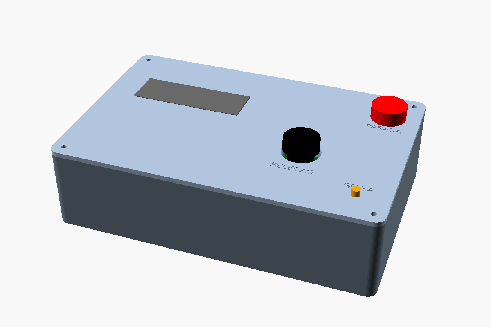
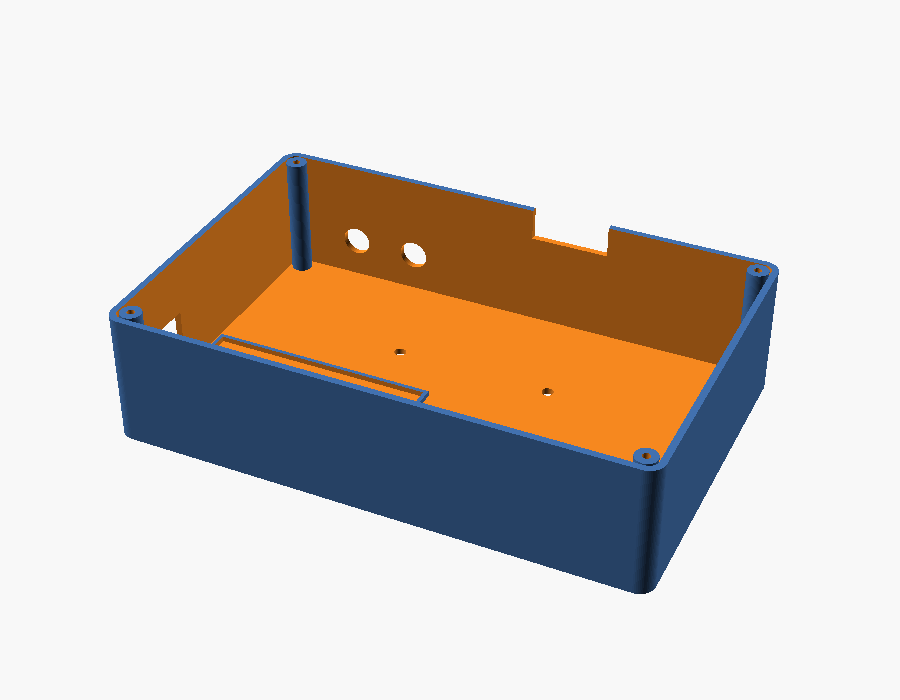

# Caixa de eletrônica para impressão 3D

Caixa com tampa que reúne a eletrônica e o painel de comando do mini elevador. Serve as duas versões da torre ([varões](../mecanica/README.md) e [toda impressa](../mecanica-impressa/README.md)) e fica ao lado dela, ligada por um feixe de cabos. Modelo de 25/11/2026, **ainda não impresso**. As cotas dos módulos são nominais e precisam ser conferidas com as peças reais.

| Montada | Caixa aberta |
|---|---|
|  |  |

## O que vai em cada lugar

**Na tampa (painel de comando):**

- **LCD 1602 com backpack I²C.** Janela de 72 × 25 mm e quatro pilares para os furos do LCD (75 × 31 mm). A frente do LCD fica rente à tampa.
- **Joystick KY-023.** Furo de 24 mm e quatro pilares de 8 mm (furos a 26,5 × 20,5 mm, **conferir**).
- **Botão de parada.** Furo de 16 mm.
- **LED de falha.** Furo de 5 mm, ligado em PB5 com resistor.

As legendas PARADA, SELECAO e FALHA são gravadas na tampa.

**No fundo da caixa:**

- **Protoboard de 400 pontos** (83 × 55 mm) num encaixe com borda: placa STM32F411.
- **Protoboard de 170 pontos** (47 × 35 mm) num encaixe com borda: ponte TB6612FNG e conversor de nível I²C.

As duas protoboards têm fita adesiva no fundo e colam dentro dos encaixes.

**Nas paredes:**

- **Esquerda:** abertura para o USB da placa STM32 (gravação e diagnóstico).
- **De trás:** dois furos de 11 mm para jaques P4 de painel (5 V e alimentação do motor) e um entalhe de 30 × 12 mm para o feixe de cabos da torre: motor, servo, 5 microchaves e 3 botões de chamada.

## Peças para imprimir

| Arquivo | Qtde | Tamanho (mm) | Posição na mesa |
|---|---|---|---|
| [stl/caixa.stl](stl/caixa.stl) | 1 | 200 × 130 × 50 | Fundo na mesa |
| [stl/tampa.stl](stl/tampa.stl) | 1 | 200 × 130 × 11 | Face de cima na mesa (o STL já vem virado) |

As duas cabem na mesa de 220 × 220 mm e imprimem sem suportes. A tampa é presa por 4 parafusos M3 × 10 que abrem rosca nos pilares dos cantos.

## Peças compradas para a caixa

- 1 protoboard de 400 pontos e 1 de 170 pontos.
- 2 jaques P4 fêmea de painel (furo de 11 mm).
- 1 botão de parada de 16 mm com contato NF.
- 4 parafusos M3 × 10 (tampa), 4 M2,5 × 6 (LCD) e 4 M2,5 × 6 (joystick).

## Antes de imprimir

Meça e, se preciso, ajuste no começo de [painel.scad](painel.scad):

- `bb1` e `bb2`: tamanho das protoboards.
- `lcd_sp` e `lcd_win`: furos e corpo do LCD.
- `joy_sp`: furos do joystick (o valor atual é estimado).
- `stop_d` e `dc_d`: diâmetro do botão de parada e dos jaques.
- `usb_z0` e `usb_z1`: altura do USB da placa espetada na protoboard.

Depois gere de novo com `.\gerar.ps1`.
