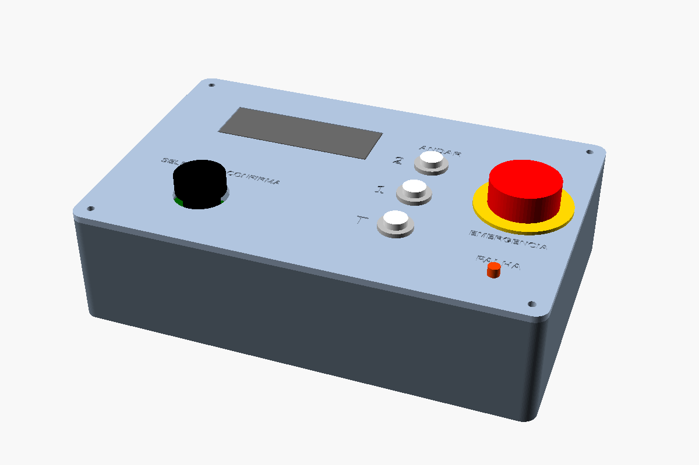
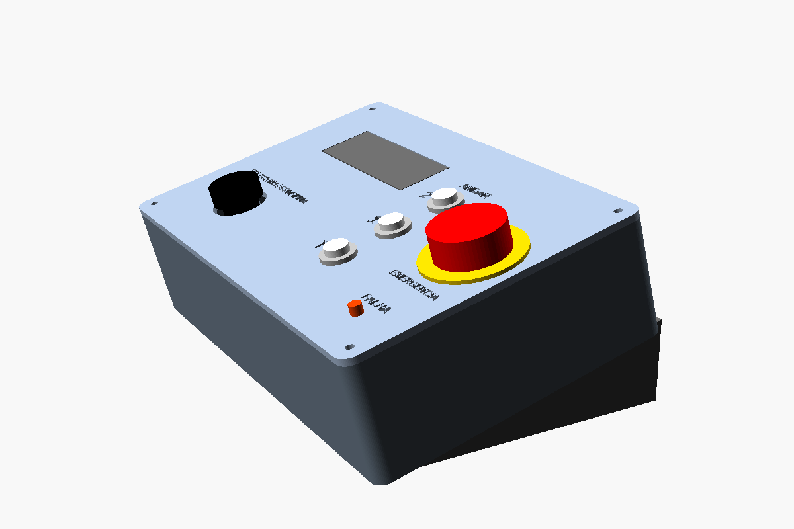
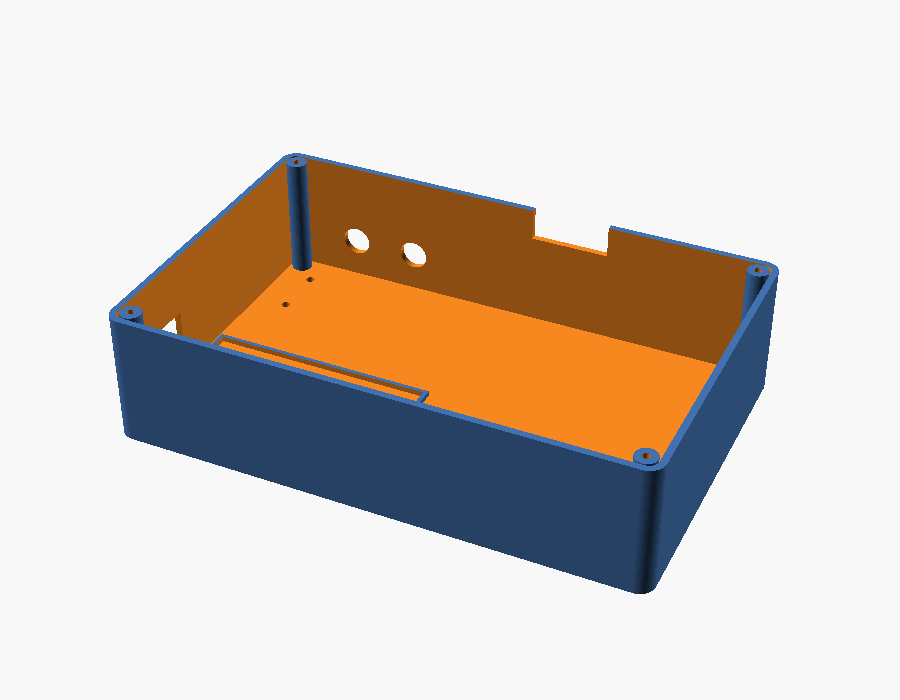

# IHM do elevador para impressão 3D

A IHM (interface homem-máquina) é a caixa de comando do mini elevador. Ela reúne o painel do operador e toda a eletrônica, e fica na bancada ao lado da torre, ligada a ela por um feixe de cabos. Serve as duas versões da torre ([varões](../mecanica/README.md) e [toda impressa](../mecanica-impressa/README.md)). Modelo de 25/11/2026, **ainda não impresso**. As cotas dos módulos são nominais e precisam ser conferidas com as peças reais.

| Montada | Sobre os calços de 15° | Caixa aberta |
|---|---|---|
|  |  |  |

## Painel (tampa)

| Elemento | O que faz | Padrão seguido |
|---|---|---|
| **LCD 1602** | Estado, último andar, destino, avisos e falhas | Informação no alto, à altura dos olhos |
| **Joystick KY-023** | Seleciona o andar; clique confirma; pressão longa faz a referência e reconhece falhas | Comando de navegação à esquerda |
| **Botões T, 1, 2** | Pedido direto de andar: um aperto seleciona e confirma | Coluna vertical com o térreo embaixo e o 2º em cima, como numa cabine |
| **Emergência** | Corta o movimento; precisa ser destravada e reconhecida | Cogumelo vermelho de 22 mm com trava, sobre fundo amarelo, à direita e afastado dos outros |
| **LED FALHA** | Acende em falha (PB5) | Vermelho, junto da emergência |

As legendas são gravadas na tampa. O [anel amarelo](stl/anel_parada.stl) vai embaixo do botão de emergência e deve ser impresso em filamento amarelo.

## Dentro da caixa

- **Protoboard de 400 pontos** (83 × 55 mm) num encaixe com borda: placa STM32F411.
- **Protoboard de 170 pontos** (47 × 35 mm) num encaixe com borda: ponte TB6612FNG e conversor de nível I²C.
- **Parede esquerda:** abertura para o USB da placa (gravação e diagnóstico).
- **Parede de trás:** dois furos de 11 mm para jaques P4 (5 V e alimentação do motor) e um entalhe de 30 × 12 mm para o feixe de cabos da torre: motor, servo e 5 microchaves.

As protoboards têm fita adesiva no fundo e colam nos encaixes. Os componentes da tampa ficam acima das protoboards, com folga para os fios.

## Peças para imprimir

| Arquivo | Qtde | Tamanho (mm) | Posição na mesa |
|---|---|---|---|
| [stl/caixa.stl](stl/caixa.stl) | 1 | 200 × 130 × 50 | Fundo na mesa |
| [stl/tampa.stl](stl/tampa.stl) | 1 | 200 × 130 × 11 | Face de cima na mesa (o STL já vem virado) |
| [stl/anel_parada.stl](stl/anel_parada.stl) | 1 | Ø42 × 1,6 | Em filamento amarelo |
| [stl/calco.stl](stl/calco.stl) | 2 | 130 × 16 × 35 | Deitado de lado (o STL já vem virado). Opcional |

Todas cabem na mesa de 220 × 220 mm e imprimem sem suportes.

## Peças compradas para a IHM

- 3 botões de pulso NA de 12 mm com rosca (T, 1, 2). Botões com LED embutido servem e ajudam a mostrar o pedido aceito, mas ainda precisariam de três saídas livres.
- 1 botão de emergência cogumelo de 22 mm com trava e contato NF.
- 1 LED vermelho de 5 mm com resistor.
- 1 protoboard de 400 pontos e 1 de 170 pontos.
- 2 jaques P4 fêmea de painel (furo de 11 mm).
- Parafusos: 4 M3 × 10 (tampa), 4 M2,5 × 6 (LCD), 4 M2,5 × 6 (joystick) e, para os calços, 4 M3 × 12 com porca.

## Ligações dos botões

| Botão | Pino | Contato |
|---|---|---|
| T | PB3 | NA para GND |
| 1 | PB4 | NA para GND |
| 2 | PB15 | NA para GND |
| Emergência | PB10 | NF para GND (abrir = falha) |
| LED FALHA | PB5 | Com resistor para GND |

O firmware liga os pull-ups internos. O contato NF da emergência lido pelo STM32 é só o diagnóstico: o corte de potência independente do software continua pendente na [ficha da etapa 2](../docs/FICHA_LEVANTAMENTO_ETAPA_2.md).

## Antes de imprimir

Meça e, se preciso, ajuste no começo de [ihm.scad](ihm.scad):

- `bb1` e `bb2`: tamanho das protoboards.
- `lcd_sp` e `lcd_win`: furos e corpo do LCD.
- `joy_sp`: furos do joystick (o valor atual é estimado).
- `btn_d`, `stop_d` e `dc_d`: diâmetro dos botões, da emergência e dos jaques.
- `usb_z0` e `usb_z1`: altura do USB da placa espetada na protoboard.
- `tilt`: inclinação dos calços.

Depois gere de novo com `.\gerar.ps1`.
