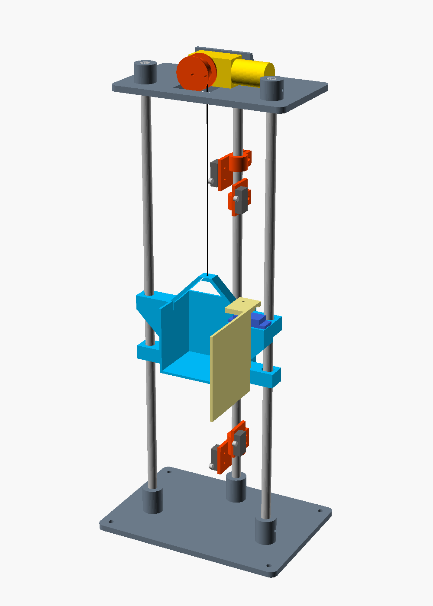
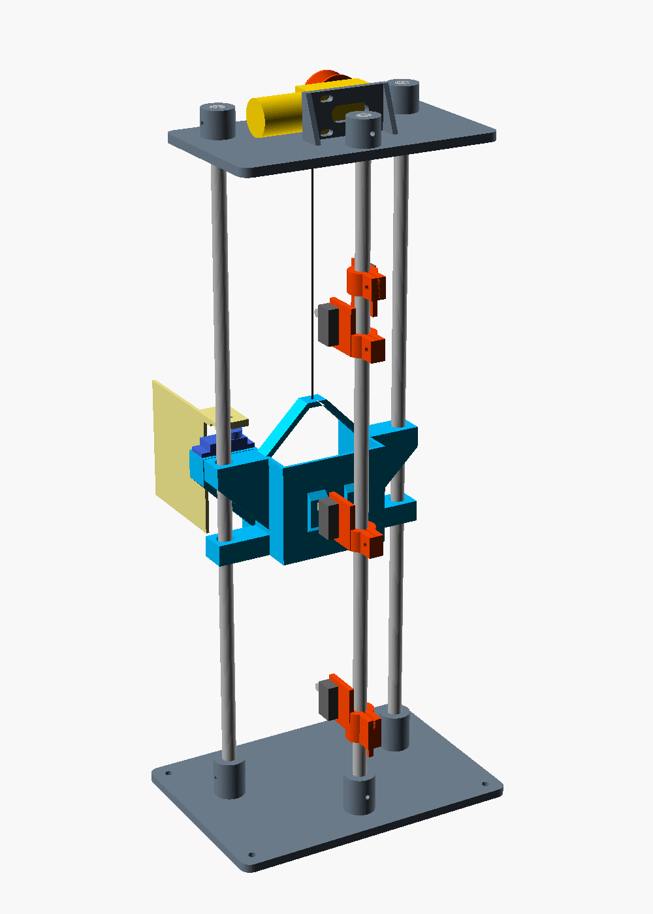
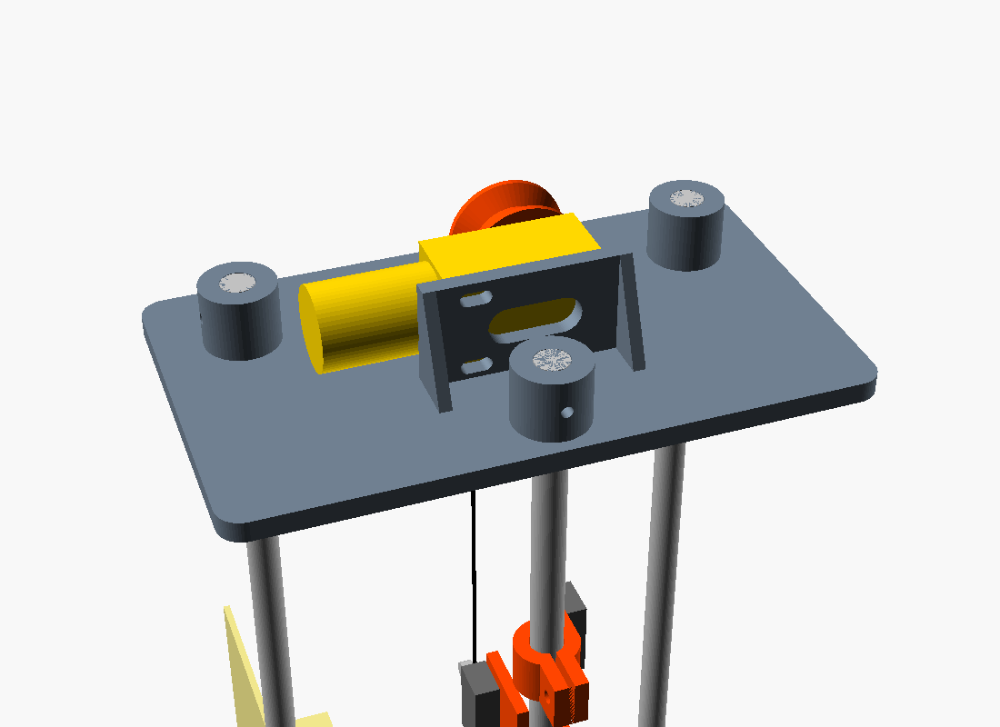

# Protótipo mecânico para impressão 3D

Proposta de estrutura para o mini elevador de três andares: motor TT com tambor e fio no topo, cabine guiada por dois varões de 8 mm, porta aberta por um servo e microchaves em braçadeiras ajustáveis num terceiro varão. Modelo de 16/11/2026, com a porta acrescentada em 18/11/2026, **ainda não impresso nem montado**. As cotas do motor e da microchave são nominais e devem ser conferidas com o gabarito antes das peças grandes.

| Vista frontal | Vista de trás | Topo com motor e tambor |
|---|---|---|
|  |  |  |

## Como funciona

- **Torre.** Base e topo impressos, unidos por três varões de 400 mm. Dois guiam a cabine, a 110 mm um do outro. O terceiro, atrás, é o mastro dos sensores.
- **Acionamento.** O motor TT fica deitado sobre o topo, parafusado numa parede vertical. O tambor de 20 mm de diâmetro encaixa no eixo e o fio desce por uma abertura até a alça da cabine.
- **Cabine.** Desliza nos varões por quatro orelhas. Um lado tem furos redondos e o outro tem rasgos, para não travar se a distância entre varões sair diferente.
- **Porta.** Um servo tipo SG90 entra por cima num alojamento na lateral direita da cabine, com o eixo para cima. A porta é uma placa presa ao braço (horn) do servo e gira 90° para fora. [Fechada](img/porta_fechada.png) · [aberta](img/porta_aberta.png)
- **Sensores.** A cabine tem dois ressaltos na face de trás. O da direita aciona as três microchaves de andar; o da esquerda aciona os dois fins de curso. Cada microchave fica numa braçadeira que sobe, desce e gira no mastro, então a altura de parada e a pressão no rolete são calibradas à mão.
- **Percurso.** 110 mm entre andares, 220 mm no total. A cabine tem 14 mm de folga abaixo do térreo e 38 mm acima do 2º andar antes dos batentes.

## Peças para imprimir

| Arquivo | Qtde | Tamanho (mm) | Posição na mesa |
|---|---|---|---|
| [stl/gabarito.stl](stl/gabarito.stl) | 1 | 64 × 50 × 10 | Como está. **Imprimir primeiro.** |
| [stl/base.stl](stl/base.stl) | 1 | 170 × 120 × 27 | Placa na mesa |
| [stl/topo.stl](stl/topo.stl) | 1 | 150 × 86 × 30 | Placa na mesa |
| [stl/cabine.stl](stl/cabine.stl) | 1 | 126 × 52 × 83 | Piso na mesa |
| [stl/porta.stl](stl/porta.stl) | 1 | 81 × 71 × 19 | Face da frente na mesa |
| [stl/bracadeira.stl](stl/bracadeira.stl) | 5 | 16 × 36 × 26 | Como está |
| [stl/tambor.stl](stl/tambor.stl) | 1 | Ø28 × 14 | Flange reta na mesa |

Todas cabem numa mesa de 220 × 220 mm e foram desenhadas para imprimir sem suportes. Sugestão de partida: PLA, camada de 0,2 mm, 3 perímetros, 20% de preenchimento.

## Peças compradas

- 3 varões lisos de 8 mm com 400 mm (uma barra de 1,2 m cortada em três). O mastro não desliza, então pode ser tubo ou vareta de 8 mm.
- 1 motor TT com redução e eixo de dois chanfros.
- 1 servo tipo SG90 com o braço reto, os dois parafusos das abas e o parafuso central que vêm com ele.
- 5 microchaves pequenas com alavanca de rolete, tipo KW12.
- 2 parafusos M3 × 25 com porca para o motor; 5 parafusos M3 × 16 com porca para as braçadeiras; 6 parafusos M3 × 8 para travar os varões.
- 10 parafusos M2 × 10 para as microchaves; 1 parafuso pequeno para a ponta do eixo do motor.
- Cerca de 1 m de linha resistente e fina (pesca ou costura reforçada).

## Antes de imprimir tudo

Imprima o gabarito e teste nele, da esquerda para a direita:

1. O varão deve entrar justo no primeiro furo e correr livre no segundo.
2. O eixo do motor deve entrar firme no furo de dois chanfros.
3. Um M3 deve passar no terceiro furo e abrir rosca no quarto. Um M2 deve abrir rosca no último.
4. Na aba fina, o eixo do motor e os dois furos de fixação devem coincidir com o motor real.

O alojamento do servo não está no gabarito. Meça o corpo do servo (nominal 22,8 × 12,2 mm, furos a 27,8 mm) antes de imprimir a cabine.

Se algo não servir, ajuste os parâmetros no começo de [elevador.scad](elevador.scad) (`fit_press`, `fit_slide`, `tt_flat`, `tt_hole_dx`, `tt_hole_sp`, `sw_hole_sp`, `servo_l`, `servo_w`, `servo_horn_z`) e gere de novo com `.\gerar.ps1`.

## Montagem

1. Encaixe os três varões na base e trave com os M3 laterais.
2. Passe a cabine pelos dois varões da frente. Ela deve cair sozinha com o próprio peso; se prender, lixe os furos.
3. Encaixe o servo no alojamento da cabine, com o eixo para cima e do lado da cabine, e prenda com os dois parafusos. Com o servo na posição de porta fechada, encaixe o braço no rebaixo da porta apontando para a frente e prenda pelo parafuso central. Deixe folga no cabo para todo o curso.
4. Coloque as cinco braçadeiras no mastro, sem apertar. Três com a aba para a direita (andares) e duas viradas de cabeça para baixo, com a aba para a esquerda (fins de curso).
5. Parafuse o motor na parede do topo, encaixe o tambor e prenda o topo nos varões.
6. Amarre o fio no furo do tambor, passe pela abertura e amarre na alça da cabine com ela apoiada na base. Enrole de modo que o fio desça pelo lado do centro da torre.
7. Com a cabine no nível de cada andar, posicione a braçadeira até a microchave clicar no meio do ressalto, e aperte. Ponha os fins de curso cerca de 8 mm além do térreo e do 2º andar.

## O que falta verificar

- **Cotas do motor TT.** Furos a 20,3 mm do eixo e 17,5 mm entre si são valores de memória, não medidos. A parede tem rasgos de ±2 mm para absorver erro.
- **Cotas da microchave.** 9,5 mm entre furos é o valor usual do tipo KW12, não conferido na peça.
- **Torque.** Com tambor de raio 10,3 mm, 100 g de cabine mais carga pedem cerca de 0,010 N·m no eixo. Falta a curva do motor real e a massa pesada da cabine.
- **Retenção sem energia.** Depende do atrito da redução do motor. Precisa ser testada com a cabine carregada; se ela descer sozinha, será preciso contrapeso ou trava.
- **Porta e servo.** Cotas do servo e altura do braço (`servo_horn_z`) são nominais. O peso do servo fica de um lado da cabine e o cabo acompanha o movimento; os dois aumentam o atrito nas guias. A porta aberta avança cerca de 70 mm à frente da cabine.
- **Eletrônica.** Placa, ponte H, LCD, joystick, botões de andar e emergência ficam na [IHM](../ihm/README.md), ao lado da torre. Fixe a base e a IHM numa mesma tábua: a torre tem 400 mm de altura e pode tombar.
- **Cabos.** Ainda não há guia para o cabo do servo, que acompanha a cabine, nem presilhas para os fios das microchaves.

Esses pontos correspondem às linhas T1, M1, R1 e S0–S2 da [ficha da etapa 2](../docs/FICHA_LEVANTAMENTO_ETAPA_2.md).

## Referências consultadas

- [Elevator Simulation Kit, de Mauricio Duarte (MakerWorld)](https://makerworld.com/en/models/870949-elevator-simulation-kit-e-book). Kit gratuito com motor TT, fio, ponte L9110S e sensor ultrassônico ou reed, quatro paradas, 483 g de PLA. É a referência mais próxima e serve de plano B. Nenhum arquivo dele foi copiado.
- [Elevador de mesa de CapeGeek (blog Arduino)](https://blog.arduino.cc/2023/12/28/desktop-elevator-provides-a-positive-sensory-experience-for-an-autistic-child/). Três andares com fuso, motor de passo e uma microchave por andar.
- [Elevator Lift Arduino (Printables)](https://www.printables.com/model/1353500-elevator-lift-arduino). Citado na documentação anterior; a página continua inacessível à leitura automática.

## Verificar colisões

`part = "colisao"` gera só as interferências entre a cabine, com a porta fechada e aberta, e as peças fixas ao longo de todo o curso:

```powershell
& "C:\Program Files\OpenSCAD\openscad.com" -o colisao.stl -D 'part=\"colisao\"' elevador.scad
```

Em 25/11/2026 o resultado só teve contatos de volume zero: a cabine apoiada no batente da base. Repita depois de mudar qualquer parâmetro.
