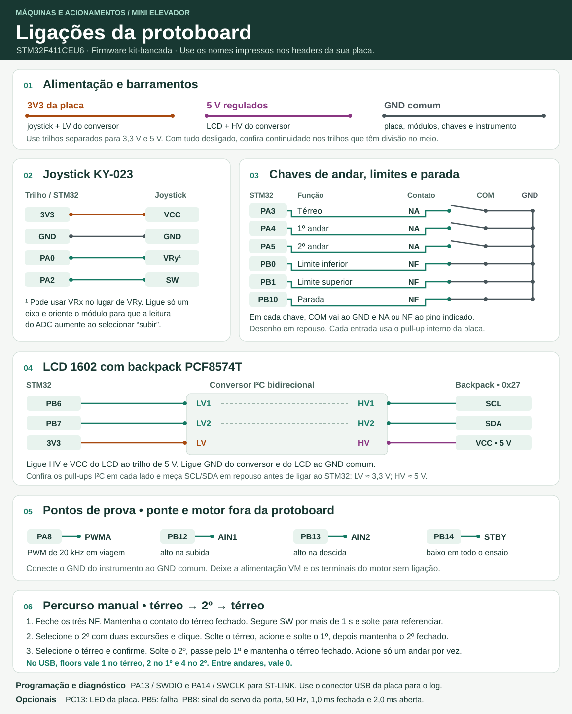

# Montar a bancada e gravar o código do mini elevador

Roteiro para o colega de equipe · 06/11/2026

Ao terminar este roteiro, você terá joystick, LCD e seis chaves ligados ao STM32. Vai representar a posição da cabine apertando as chaves e testar uma viagem do térreo ao 2º andar e de volta. **Faça esta primeira montagem com o motor, a ponte e a alimentação do motor desconectados.** O firmware de bancada mantém STBY baixo.

## 1. Baixe o projeto e separe as peças

Abra o [IFSC_MAQ](https://github.com/mateusalgado/IFSC_MAQ), clique em **Code → Download ZIP** e extraia tudo em uma pasta. Os próximos caminhos partem da pasta extraída, que contém o README e a pasta `elevador`.

Se preferir usar Git, execute:

```powershell
git clone https://github.com/mateusalgado/IFSC_MAQ.git
cd IFSC_MAQ
```

Separe:

- 1 placa com **STM32F411CEU6 e cristal externo de 25 MHz**, protoboard e jumpers. Confira o chip e o cristal antes de gravar. O cristal é premissa desta imagem.
- 1 ST-LINK compatível com a placa e 1 cabo USB de dados para o conector USB do STM32.
- 1 joystick analógico com botão, tipo KY-023.
- 1 LCD 1602 com backpack **PCF8574T em 0x27** e 1 conversor de nível I²C bidirecional 3,3/5 V com pull-ups nos dois lados.
- 3 chaves com contato normalmente aberto (NA), uma por andar. Podem ser botões, desde que você mantenha o botão do andar atual apertado quando a cabine estiver parada.
- 2 chaves com contato normalmente fechado (NF), para limite inferior e superior, e 1 botão com contato NF, para parada. Para representar manualmente um NF, também serve uma chave de duas posições que você mantenha fechada em repouso.
- Alimentação de 5 V regulados para o LCD, multímetro e, se disponível, osciloscópio ou analisador lógico compatível com 3,3 V.

Identifique as chaves com etiquetas **T, 1, 2, LI, LS e PARADA**. Na protoboard, confira quais grupos de cinco furos têm continuidade e onde os trilhos de alimentação são interrompidos.

Instale o **STM32CubeProgrammer** e o driver do ST-LINK. No Windows, o instalador da ST inclui o procedimento de instalação desse driver. Para acompanhar os registros, use um terminal serial, como PuTTY. [STM32CubeProgrammer](https://www.st.com/en/development-tools/stm32cubeprog.html) · [Instalação e driver](https://dev.st.com/stm32cube-docs/prog/2.23.0/en/docs/markup/CubeProg_How_To_Start/CubeProg_Installation.html) · [PuTTY](https://www.chiark.greenend.org.uk/~sgtatham/putty/latest.html)

## 2. Monte a lógica na protoboard

Faça as ligações com todas as alimentações desligadas. Abra o [diagrama pino a pino](DIAGRAMA_KIT_BANCADA.svg) ao lado deste roteiro.



### Alimentação

1. Reserve três trilhos identificados como **3V3**, **5 V LCD** e **GND**. Os trilhos de 3,3 V e 5 V devem ficar separados.
2. Ligue GND da placa, GND do joystick, GND do conversor e GND do LCD ao trilho GND. O negativo da fonte de 5 V do LCD também vai ao GND.
3. Ligue o pino 3V3 da placa ao trilho 3V3. Use esse trilho para alimentar o joystick e a entrada **LV** do conversor.
4. Ligue os 5 V regulados à entrada **HV** do conversor e ao VCC do LCD. Nesta montagem, a placa recebe alimentação pelo próprio USB. A fonte de 5 V do LCD alimenta o LCD e o lado HV do conversor.

### Joystick e chaves

Os pinos abaixo são os nomes do STM32. Localize esses nomes no esquema ou na marcação da sua placa.

| Origem | Destino | O que conferir |
|---|---|---|
| Joystick VCC | Trilho 3V3 | Mesmo que o módulo tenha uma marcação “5V”, este ensaio usa 3,3 V no joystick. |
| Joystick GND | Trilho GND | Referência comum com o STM32. |
| Joystick VRy | PA0 | Use um eixo. Se escolher VRx, adapte a orientação do movimento. |
| Joystick SW | PA2 | O botão fecha para GND. |
| NA da chave T | PA3 | COM dessa chave no GND. |
| NA da chave 1 | PA4 | COM dessa chave no GND. |
| NA da chave 2 | PA5 | COM dessa chave no GND. |
| NF da chave LI | PB0 | COM no GND. Fechada em repouso. |
| NF da chave LS | PB1 | COM no GND. Fechada em repouso. |
| NF da PARADA | PB10 | COM no GND. Fechada em repouso. |

Cada chave tem seu próprio fio de sinal. Todas compartilham o GND. O firmware habilita os pull-ups internos dessas entradas. Em botões tácteis de quatro pernas, use o multímetro para escolher duas pernas que só se conectam ao apertar.

### LCD

| Origem | Destino |
|---|---|
| PB6 | LV1 do conversor |
| HV1 do conversor | SCL do backpack |
| PB7 | LV2 do conversor |
| HV2 do conversor | SDA do backpack |
| LV do conversor | Trilho 3V3 |
| HV do conversor e VCC do LCD | Trilho 5 V LCD |
| GND do conversor e do LCD | Trilho GND |

O backpack assumido pelo código usa P0=RS, P1=RW, P2=E, P3=luz e P4–P7=D4–D7. Confira **PCF8574T e endereço 0x27** no módulo. Deixe PA8, PB12, PB13 e PB14 apenas como pontos de prova. PB8 leva o sinal do servo da porta e também pode ficar só como ponto de prova. Os botões de andar da IHM (T, 1 e 2 em PB3, PB4 e PB15, cada um para GND) são opcionais neste roteiro. PB5 pode ficar livre e PC13 usa o LED da própria placa, quando presente.

Antes de conectar SCL e SDA ao STM32, energize as alimentações e confira no multímetro aproximadamente **3,3 V no lado LV** e **5 V no lado HV**, com o barramento em repouso. Depois desligue, complete as ligações e confira a ausência de curto entre os trilhos.

## 3. Grave o firmware pronto

A imagem deste roteiro está em:

```text
elevador/firmware/kit-bancada/elevador-kit-bancada.hex
```

Ela já acompanha o projeto baixado. A compilação a partir das fontes está na seção 7.

1. Com a montagem desligada, ligue **SWDIO do ST-LINK a PA13**, **SWCLK a PA14** e **GND a GND**. Quando o programador tiver uma entrada de referência **VTref/VAPP**, ligue-a ao 3V3 da placa conforme o manual dele. Identifique se o pino “3V3” do seu programador é uma saída de alimentação ou uma entrada de referência antes de conectá-lo. NRST pode ser ligado ao reset da placa para recuperação sob reset.
2. Alimente a placa pelo USB e conecte o ST-LINK ao computador. Mantenha BOOT0 na posição normal de execução pela Flash da placa.
3. Abra o STM32CubeProgrammer, selecione **ST-LINK**, interface **SWD**, e clique em **Connect**. Confira se ele identifica a família STM32F411.
4. Abra a área de gravação de arquivos, selecione `elevador-kit-bancada.hex`, habilite a verificação da gravação e execute **Start Programming**. O arquivo HEX contém os endereços de Flash.
5. Aguarde o resultado de gravação e verificação bem-sucedidas. Salve uma captura desse resultado.
6. Desconecte a sessão do programador e reinicie a placa. Se necessário, desligue tudo para retirar os fios do ST-LINK e volte a alimentar o conjunto.

Os nomes dos controles podem variar conforme a versão do programa. O manual oficial descreve conexão, gravação e verificação. [Manual STM32CubeProgrammer, UM2237](https://www.st.com/resource/en/user_manual/um2237-stm32cubeprogrammer-software-description-stmicroelectronics.pdf)

## 4. Confira as entradas pelo USB

1. No Gerenciador de Dispositivos do Windows, encontre a porta COM que aparece ao conectar o **USB do STM32**.
2. No PuTTY, escolha **Serial**, essa porta COM e velocidade **115200**. Use 8 bits, sem paridade, um stop bit e controle de fluxo **None**. A aplicação transmite por USB CDC.
3. Para registrar o teste, em **Session → Logging**, escolha guardar a saída da sessão em um arquivo com seu nome e data. Abra a conexão.
4. Deixe LI, LS e PARADA fechados, joystick solto e as três chaves de andar abertas. Espere registros semelhantes a:

```text
state=INICIO ... pwm=0 ... adc=2048 btn=0 floors=0 low=0 high=0 stop=0 valid=1
```

O valor do ADC varia perto do centro. Ao mover o joystick para o sentido escolhido como “subir”, a leitura deve aumentar. Ao fechar T, 1 ou 2 individualmente, `floors` deve valer **1, 2 ou 4**, respectivamente. Ao abrir LI, LS ou PARADA, o campo correspondente fica em 1 e aparece FALHA. Depois de fechar novamente, segure SW por mais de 1 s e solte para reconhecer.

Os registros aparecem nas mudanças de estado e periodicamente. Para observar um contato pelo terminal, mantenha-o na condição de teste por tempo suficiente para aparecer em um registro.

## 5. Faça o percurso dos três andares

Use a sequência abaixo com os contatos NF fechados. A chave do andar atual deve ficar fechada enquanto a cabine simulada estiver parada.

1. **Referência no térreo.** Feche T e deixe 1 e 2 abertos. Solte SW antes de começar. Segure SW por mais de 1 s e solte. O estado passa pela referência e chegada até **PARADO**, com último andar 0. Nesse momento a porta abre (`door=1` no terminal).
2. **Seleção do 2º.** Mova o joystick para cima, volte ao centro, mova para cima outra vez e volte ao centro. Confira seleção 2 no LCD. Dê um clique curto em SW.
3. **Saída do térreo.** Depois do clique o LCD mostra “Fechando porta” por 0,8 s. Mantenha T fechado nesse tempo. Quando aparecer SUBIDA, abra T em menos de **2 s**.
4. **Passagem pelo 1º.** Feche 1 por cerca de **0,2 s** e abra novamente.
5. **Chegada ao 2º.** Feche 2 e mantenha fechado. Faça a viagem inteira em menos de **20 s**. O comando PWM deve ir a zero e, depois de 300 ms de confirmação, o estado deve ser PARADO no andar 2.
6. **Volta ao térreo.** Mova para baixo duas vezes, voltando ao centro entre elas. Confirme com clique curto. Abra 2 em menos de 2 s, feche e abra 1 por cerca de 0,2 s e feche T até PARADO.
7. **Parada no 1º.** A partir do térreo, selecione apenas um andar acima e confirme. Abra T, feche 1 e mantenha fechado até PARADO. Volte ao térreo da mesma forma. Isso verifica a parada no andar intermediário.

Se tiver instrumento, meça PA8 em referência ao GND. Durante viagem ele apresenta PWM de 20 kHz, com rampa até o comando provisório de 25%. PB12 indica subida, PB13 descida, e **PB14 deve permanecer baixo em todo o teste**.

## 6. Teste a falha e entregue o registro

Durante uma viagem simulada, abra PARADA. Confira FALHA e PWM zero. Feche o contato, segure SW por mais de 1 s e solte. O sistema volta a INICIO. Uma **nova** pressão longa solicita referência. Repita com LI e LS. Em outro ensaio, feche duas chaves de andar ao mesmo tempo para conferir falha de sensor.

| O que aconteceu | Onde conferir |
|---|---|
| ST-LINK não conecta | Alimentação, GND comum, PA13/PA14 e driver do programador. Se houver reset repetido, tente conexão sob reset com NRST ligado. |
| Porta COM não aparece | Cabo USB de dados, conector do STM32, gravação concluída e placa/cristal compatíveis. |
| FALHA de limite ou parada ao iniciar | LI, LS e PARADA devem fechar para GND em repouso. Confira `low`, `high` e `stop`. |
| LCD vazio, mas USB funciona | Contraste, alimentação, conversor, endereço 0x27 e mapeamento do backpack. |
| FALHA após chegar ao andar | Mantenha a chave do andar atual fechada enquanto PARADO e enquanto a porta fecha. |
| FALHA durante o percurso | Solte a chave de partida em menos de 2 s, passe pelo intermediário e conclua em menos de 20 s. |
| FALHA de entrada ou reset repetido | Guarde o log, confira alimentação e identificação da placa e peça revisão antes de prosseguir. |

Preencha e envie à equipe o registro abaixo com o arquivo de log e as fotos.

- Data e responsável ____________________
- Modelo e marcação do MCU / cristal ____________________
- Foto geral da montagem e foto dos pinos ____________________
- Nome do HEX e SHA-256 conferido ____________________
- Resultado da gravação e verificação ____________________
- Referência no térreo / subida / descida / parada no 1º ____________________
- Parada / LI / LS / sensores simultâneos ____________________
- Arquivo do log USB e eventuais medições ____________________
- Divergência observada, ação realizada e campo do log correspondente ____________________

A montagem mecânica e o ensaio com motor começam depois de preencher a [ficha da etapa 2](FICHA_LEVANTAMENTO_ETAPA_2.md), definir retenção e corte independente, dimensionar o acionamento e validar o motor desacoplado. A estrutura de referência previa NEMA 17 e a proposta atual considera motor CC com redução, por isso o suporte e a transmissão ainda exigem conferência.

## 7. Para recompilar o código

Use esta seção se você alterar as fontes ou quiser reproduzir o HEX. Instale Python 3.9 ou superior e um compilador GNU Arm Embedded, como o incluído no STM32CubeIDE. Os demais fontes de HAL, USB e FreeRTOS acompanham a cópia histórica no repositório. [Python para Windows](https://www.python.org/downloads/windows/) · [STM32CubeIDE](https://www.st.com/en/development-tools/stm32cubeide.html)

Abra um PowerShell **na pasta `elevador`** do projeto extraído. Se o STM32CubeIDE estiver em `C:\ST`, execute:

```powershell
python --version
$cc = (Get-ChildItem C:\ST -Recurse -Filter arm-none-eabi-gcc.exe | Select-Object -First 1).FullName
if (-not $cc) { throw 'Localize arm-none-eabi-gcc.exe na instalação do compilador.' }
python scripts/build_f411.py --cc $cc --profile kit-bancada
if ($LASTEXITCODE -ne 0) { throw 'A compilação falhou. Guarde a saída para a equipe.' }
```

Se o compilador estiver em outra pasta, atribua a `$cc` o caminho completo para `arm-none-eabi-gcc.exe`. Em uma instalação que disponibilize `py` em vez de `python`, use `py -3` nos dois comandos de Python.

O resultado atualizado fica em `build/f411/kit-bancada/elevador-kit-bancada.hex`. Grave esse arquivo pelo mesmo procedimento da seção 3. Para rastrear o ensaio, registre o hash:

```powershell
Get-FileHash build/f411/kit-bancada/elevador-kit-bancada.hex -Algorithm SHA256
```

Os testes de lógica podem ser executados em Linux/WSL com GCC e Make, na pasta `elevador`, usando `make -B test` e `make sanitize`. Os resultados da publicação estão no [registro de validação](VALIDACAO_PUBLICACAO_2026-11-06.md).

[Voltar ao guia de bancada](KIT_BANCADA.md) · [Sumário do projeto](../README.md)
