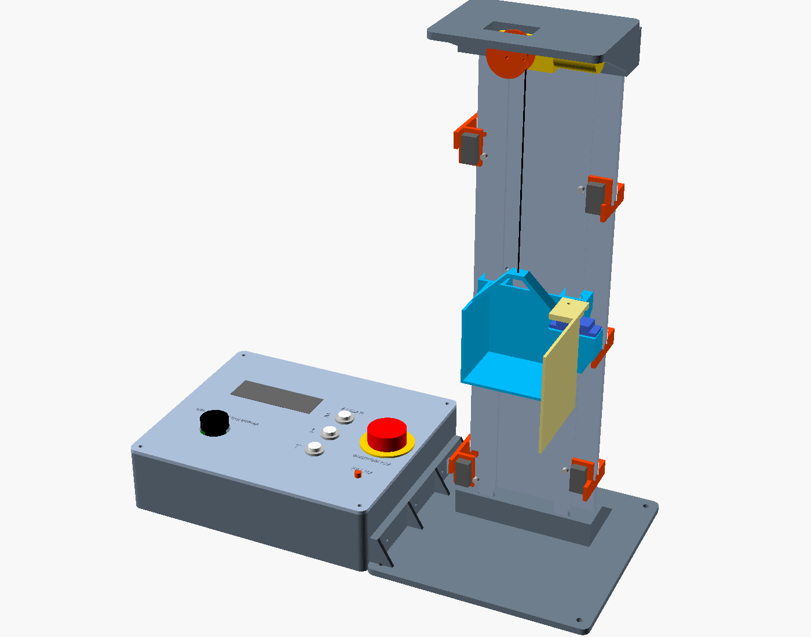
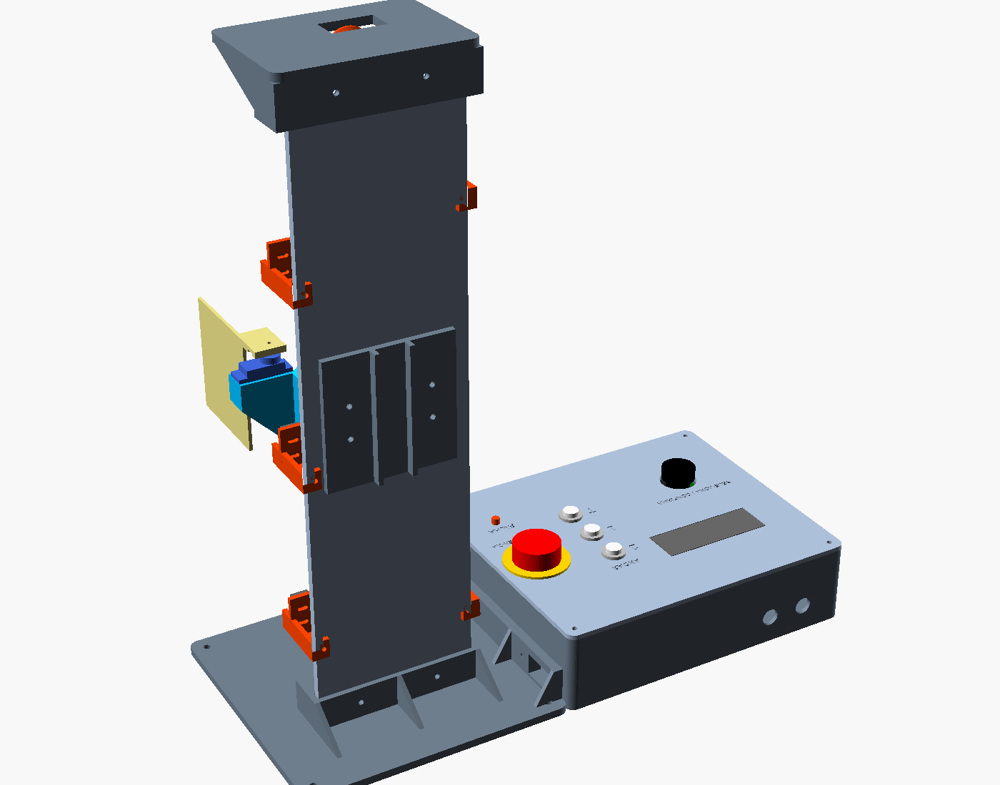
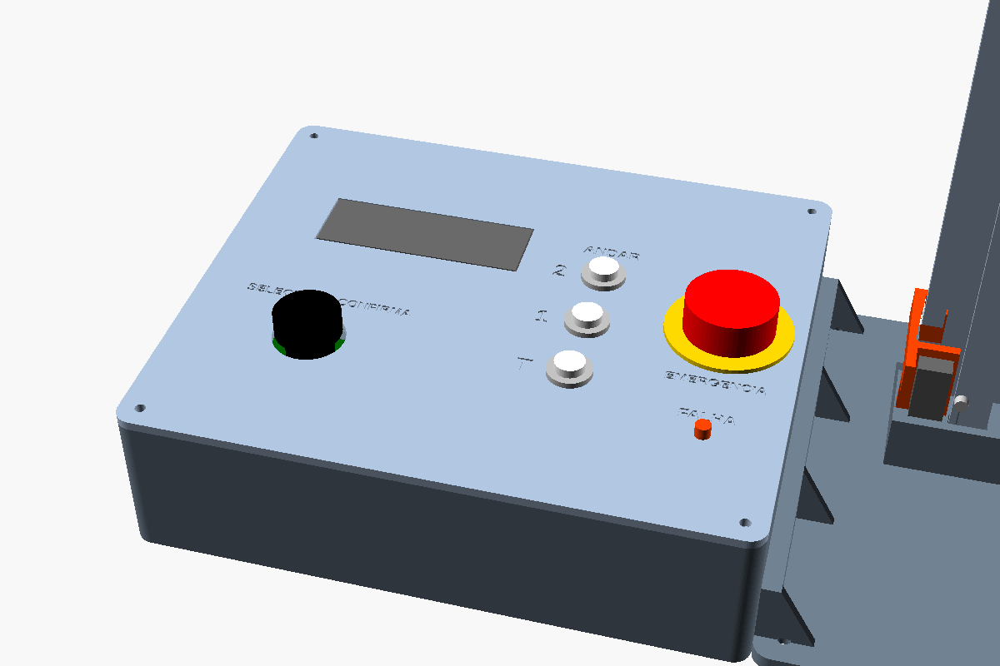

# Mini elevador · peças para impressão 3D

Modelo completo do mini elevador, com a estrutura toda impressa: torre, cabine, porta, suportes dos sensores e a IHM (caixa de comando) presa na base. Não há varões, perfis nem tábua. Do material comprado sobram só parafusos, a linha do tambor e os componentes eletrônicos. Versão de 26/11/2026, **ainda não impressa**. As cotas dos componentes são nominais: imprima o gabarito antes das peças grandes.

| Conjunto | Vista de trás | IHM |
|---|---|---|
|  |  |  |

## Como é

- **Base única.** A base mede 370 × 170 mm e não cabe inteira na mesa da impressora, por isso sai em dois módulos: a base da torre (170 × 170 mm) e a caixa da IHM (200 × 170 mm). Uma flange na borda esquerda da base da torre se aparafusa por dentro da caixa da IHM com três M3. Depois de montadas, as duas formam um bloco rígido que fica em pé sozinho.
- **Torre.** Coluna de 400 mm em dois segmentos iguais com dois trilhos em cauda de andorinha na frente, unidos por uma emenda nas costas. Encaixa na base embaixo e na cabeça em cima.
- **Acionamento.** O motor TT fica deitado sob o teto da cabeça. O tambor de 20 mm no eixo enrola a linha, que desce até a alça da cabine.
- **Cabine.** Corre nos trilhos por quatro sapatas, na frente da coluna. Tem um ressalto em cada lateral para acionar as microchaves.
- **Porta.** Um servo SG90 encaixa por cima na lateral direita da cabine e gira a porta 90°. [Fechada](img/porta_fechada.png) · [aberta](img/porta_aberta.png)
- **Sensores.** Cinco grampos deslizam nas bordas da coluna, cada um com uma microchave: três de andar à direita e dois fins de curso à esquerda.
- **IHM.** Na tampa: LCD 1602, joystick, botões de andar T, 1 e 2 em coluna, emergência de 22 mm sobre anel amarelo e LED de falha. Dentro: protoboards da placa STM32 e da ponte H, USB na parede esquerda e dois jaques P4 atrás. Os cabos da torre entram pela passagem na junção, sem ficar soltos por fora.
- **Percurso.** 110 mm entre andares, 220 mm no total.

## Peças para imprimir

Imprima nesta ordem. Todas cabem numa mesa de 220 × 220 mm e foram desenhadas para imprimir sem suportes.

| # | Arquivo | Qtde | Tamanho (mm) | Massa aprox. | Posição na mesa |
|---|---|---|---|---|---|
| 1 | [gabarito.stl](stl/gabarito.stl) | 1 | 64 × 89 × 19 | 27 g | Como está. **Imprimir primeiro e testar.** |
| 2 | [base.stl](stl/base.stl) | 1 | 170 × 170 × 26 | 255 g | Placa na mesa |
| 3 | [segmento.stl](stl/segmento.stl) | 2 | 100 × 195 × 19 | 169 g cada | Costas na mesa, trilhos para cima. Use aba (brim) |
| 4 | [emenda.stl](stl/emenda.stl) | 1 | 80 × 80 × 10 | 35 g | Face lisa na mesa |
| 5 | [cabeca.stl](stl/cabeca.stl) | 1 | 116 × 80 × 30 | 124 g | Teto na mesa (o STL já vem virado) |
| 6 | [cabine.stl](stl/cabine.stl) | 1 | 103 × 64 × 83 | 57 g | Piso na mesa |
| 7 | [porta.stl](stl/porta.stl) | 1 | 81 × 70 × 19 | 13 g | Como está |
| 8 | [grampo.stl](stl/grampo.stl) | 5 | 16 × 40 × 26 | 4 g cada | Como está |
| 9 | [tambor.stl](stl/tambor.stl) | 1 | Ø28 × 14 | 7 g | Flange reta na mesa |
| 10 | [ihm_caixa.stl](stl/ihm_caixa.stl) | 1 | 200 × 170 × 50 | 223 g | Fundo na mesa |
| 11 | [ihm_tampa.stl](stl/ihm_tampa.stl) | 1 | 200 × 170 × 11 | 116 g | Face de cima na mesa (o STL já vem virado) |
| 12 | [anel_parada.stl](stl/anel_parada.stl) | 1 | Ø42 × 1,6 | 2 g | Em filamento amarelo |

As massas são de peças maciças em PLA, um limite superior. O total fica perto de 1,2 kg maciço e cai para uns 800 a 900 g com 20% de preenchimento: conte com um rolo de 1 kg, com folga pequena.

Sugestão de partida: PLA, camada de 0,2 mm, 3 perímetros, 20% de preenchimento. O segmento ocupa quase toda a mesa no comprimento: se as pontas levantarem, os trilhos empenam e a cabine prende.

## Antes de imprimir as peças grandes

O gabarito testa os encaixes de que o projeto depende:

1. **Trilho e sapata.** A sapata deve correr pelo trecho de trilho com o próprio peso, sem folga lateral perceptível. Este é o teste mais importante.
2. **Barra.** O eixo do motor deve entrar firme no furo de dois chanfros. Um M3 deve passar no segundo furo e abrir rosca no terceiro. Um M2 deve passar no quarto. A fenda na ponta deve entrar justa na espessura do trecho de coluna.
3. **Chapa.** O furo grande e os dois pequenos devem coincidir com o eixo e os furos de fixação do motor real.

O gabarito ainda não testa o servo, os botões, o LCD e o joystick. Meça essas peças com paquímetro antes de imprimir a cabine e a IHM.

Se algo não servir, ajuste os parâmetros no começo dos arquivos e gere de novo com `.\gerar.ps1`:

- [elevador.scad](elevador.scad): `fit_slide`, `fit_sock`, `tt_flat`, `tt_hole_dx`, `tt_hole_sp`, `sw_hole_sp`, `servo_l`, `servo_w`, `servo_horn_z`.
- [ihm.scad](ihm.scad): `bb1`, `bb2`, `lcd_sp`, `lcd_win`, `joy_sp`, `btn_d`, `stop_d`, `dc_d`, `usb_z0`, `usb_z1`.
- [comum.scad](comum.scad): tamanho da base e posição da junção, usados pelos dois arquivos.

## Material comprado

**Fixação e transmissão:**

- Parafusos M3: 2 × 25 (motor), 3 × 10 (junção base–IHM), 8 × 8 (coluna na base, na emenda e na cabeça), 5 × 8 (grampos) e 4 × 10 (tampa da IHM). Abrem rosca no plástico, sem porca.
- Parafusos M2 × 12 com porca: 10 (microchaves).
- Parafusos M2,5 × 6: 8 (LCD e joystick).
- 1 parafuso pequeno para a ponta do eixo do motor.
- Cerca de 1 m de linha de pesca trançada de 0,3 a 0,5 mm.

**Componentes que encaixam nas peças:** motor TT, servo SG90, 5 microchaves KW12 com rolete, LCD 1602 com backpack I²C, joystick KY-023, 3 botões de pulso de 12 mm, emergência cogumelo de 22 mm com trava, LED de 5 mm, protoboards de 400 e de 170 pontos e 2 jaques P4 de painel. A lista completa de eletrônica está no [hardware](../docs/HARDWARE.md).

## Montagem

1. Aparafuse a caixa da IHM na flange da base da torre com três M3 × 10, por dentro da caixa. Confira que as duas peças ficam apoiadas por igual na mesa.
2. Encaixe um segmento na base e trave com dois M3 pelas costas.
3. Apoie o segundo segmento sobre o primeiro e parafuse a emenda nas costas com quatro M3. Passe o dedo nos trilhos sobre a junção; se houver degrau, lixe até ficar liso.
4. Coloque os cinco grampos nas bordas da coluna, sem apertar.
5. Encaixe o servo no alojamento da cabine, com o eixo para cima, e prenda com os dois parafusos. Com o servo na posição de porta fechada, encaixe o braço no rebaixo da porta apontando para a frente e prenda pelo parafuso central. Deixe folga no cabo para todo o curso.
6. Enfie a cabine nos trilhos por cima. Ela deve descer sozinha até a base.
7. Parafuse o motor na cabeça com os dois M3 × 25, encaixe o tambor e prenda a cabeça no topo da coluna com dois M3.
8. Amarre a linha no furo do tambor e na alça da cabine, com a cabine apoiada na base. Enrole de modo que a linha desça pelo lado do centro da torre.
9. Com a cabine no nível de cada andar, deslize o grampo até a microchave clicar no meio do ressalto e aperte o parafuso. Ponha os fins de curso cerca de 8 mm além do térreo e do 2º andar.
10. Passe os cabos da torre pela abertura da junção para dentro da IHM. Monte a eletrônica nas protoboards, prenda LCD, joystick, botões, emergência e LED na tampa e feche a caixa com quatro M3.

## O que falta verificar

- **Deslizamento.** Plástico correndo em plástico é o maior risco desta estrutura. Só o gabarito diz se a folga de 0,35 mm serve. Um pouco de lubrificante seco de PTFE nos trilhos ajuda.
- **Cabine em balanço.** O peso do servo e da porta fica na frente e de um lado, o que tende a inclinar a cabine e prender as sapatas. Se acontecer, deslocar a alça da linha para o lado do servo.
- **Retenção.** A redução do motor TT não é autotravante: a cabine pode descer sozinha quando o motor para. Testar com carga; a [revisão](../docs/REVISAO_PROJETO_2026-11-25.md) traz as correções.
- **Cabo do servo.** Acompanha a cabine e ainda não tem guia nem presilha.
- **Cotas.** Motor, servo, microchave, LCD, joystick e botões usam valores nominais, não medidos.

## Verificar colisões

`part = "colisao"` gera só as interferências entre a cabine, com a porta fechada e aberta, e as peças fixas ao longo de todo o curso:

```powershell
& "C:\Program Files\OpenSCAD\openscad.com" -o colisao.stl -D 'part=\"colisao\"' elevador.scad
```

Em 26/11/2026 o resultado só teve contatos de volume zero: a cabine apoiada no batente da base. Repita depois de mudar qualquer parâmetro.

Versões anteriores, como a torre com varões de aço e a IHM separada, estão em [arquivo/versoes](../arquivo/versoes/README.md).
